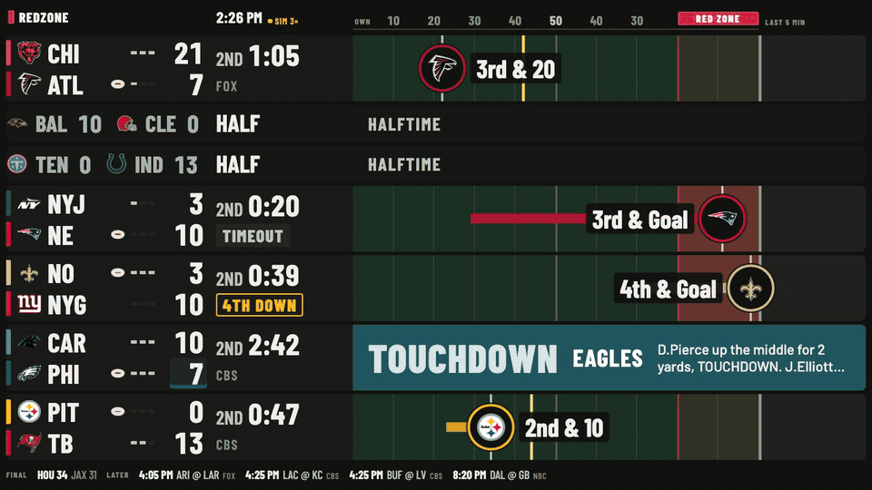
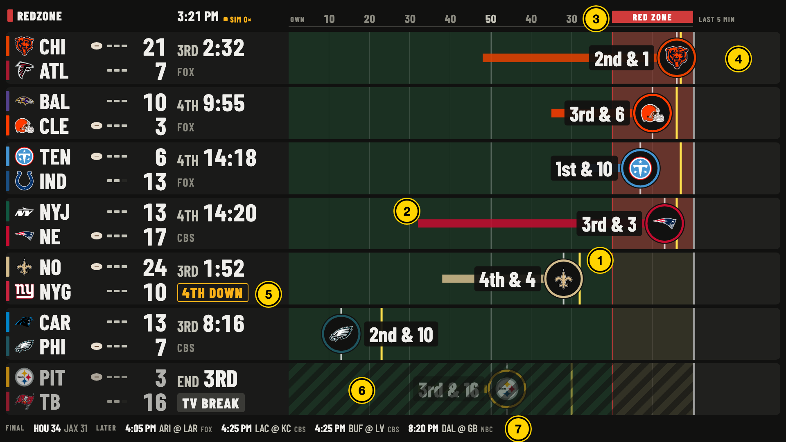
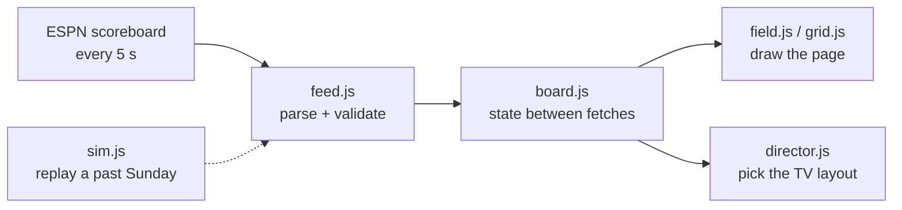
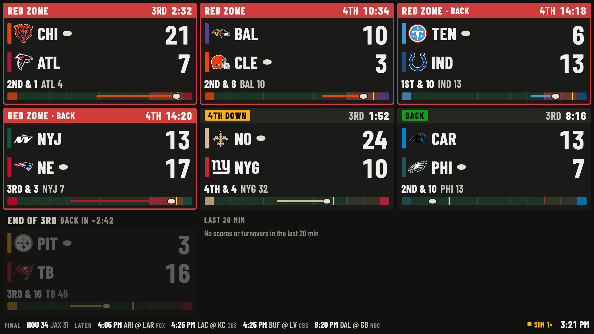
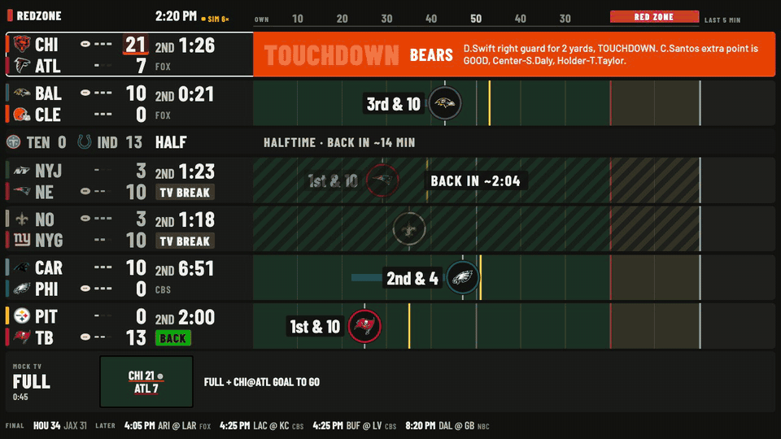

# DIY_REDZONE

Live NFL Sunday game-switching project because the YoutubeTV multiview experience sucks




*Replay of 2026-10-18, 2:26 PM ET, at 4.5× speed: three touchdowns in 90 seconds.*

### Status

- V1 is just a dashboard that I put on a second monitor next to our main TV. It has the live game feeds so we can switch between channels and it tells us which games are close, which just had turnovers, which are on TV break, etc.
- Channel Director is the skeleton of what will eventually become the logic for controlling the main TV's multiview live during the 1PM and 4:30 slate, hence "DIYREDZONE". It knows what is on advertisement, what games just had big plays, and can priority-rank based on a loose set of rules. not sure how that will evolve.
- The next step is getting channel director to serve the youtube tv feeds, probably over chromecast otherwise it will require hdmi splitter. another option is developer mode on my google TV and using remotecontrol (which I could run from my laptop instead of the pi3b currently hosting it)
- Automute is shelved despite being the original idea
- "headless mode" would be with no dashboard display, just the game-director. This is what the final product will be hopefully. Dashboard is kind of an intermediary for the game-switching logic and a checkpoint for latency on the live feeds. Live feed worked pretty good Sunday 10/25, was even ahead of our main tv at times during the later games. dashboard display itself could run easily on an esp32 its like 4 pieces of JS and a served HTML file.

### Slate Display



1. **Ball:** the offense's logo on the line of scrimmage, with down and distance. Every offense drives left to right, so the game closest to scoring is furthest right.
2. **Drive:** the bar is this drive; the yellow line is the line to gain.
3. **Red zone:** one column down every lane, shaded while any ball is in it.
4. **End zone:** the latest score or turnover, held for 5 minutes.
5. **Status chip:** `4TH DOWN`, `CLOSE & LATE`, `BACK` from commercial, and others (see *Status chips* under How it works).
6. **Commercial:** the lane is hatched and dimmed, with a `BACK IN ~1:48` countdown.
7. **Schedule rail:** finals and games still to come.

- **Running** on the `nova` wall display at `http://nova:8083/`.
- **Channel director** recommends one game full screen, a split, or a quad. The channel still changes by hand.
- **Next Sunday (2026-11-01):** first try at having those picks set the TV's panels directly.

## Quick start

```sh
cd board
python3 -m http.server 8083   # open http://localhost:8083/
npm test                      # Node 22+, no dependencies
```


## How it works



- `feed.js` turns each ESPN response into plain game objects and decides whether a score change is real.
- `board.js` remembers what ESPN doesn't: when a commercial started, what scored recently, when a game last moved.
- `field.js` and `grid.js` read that state and redraw twice a second. They never write back.
- `director.js` reads the same state and picks full, split or quad, with reasons.
- `sim.js` rebuilds a past slate in ESPN's live format, so a replay runs the real code.

It's plain JavaScript modules, CSS and one `index.html`: no backend, no build
step, no dependencies. The browser fetches ESPN directly, which ESPN allows.

<details>
<summary><b>Code structure in detail</b></summary>

The page is a small pipeline with a pure core and a thin DOM layer on top.

`feed.js` is the parser. It turns one ESPN scoreboard response into a list of
plain game objects (teams, score, clock, possession, field position, last
play) and holds the rules that only need one snapshot: what kind of play just
happened, and whether the game is in a commercial. It also has `ScoreWatch`,
which decides whether a score change is real. Nothing in it does I/O.

`board.js` is the state store. `createBoard()` owns fetching, the delay queue
and per-game history, and exposes read-only queries such as `games()`,
`hist()`, `breakLeft()`, `isBack()`, `recent()` and `feed()`. Its input is
either live fetches or `sim.js`, so nothing downstream can tell a replay from a
live Sunday.

`field.js` and `grid.js` each export `mount()`, which builds the DOM once, and
`render(board, gameTime, realTime)`, which updates it. `ui.js` holds what both
views share: text formatting, team colors, and DOM setters that skip the write
when the value hasn't changed, which keeps twice-a-second rendering cheap.
`tv.js` draws the director's pick as a strip on the field view. `app.js` wires
everything together from the URL parameters.

`feed.js`, `board.js`, `sim.js` and `director.js` never touch the DOM, so
`node --test` runs them directly against saved ESPN fixtures, and
`director-replay.js` runs the director over a whole past Sunday from the
command line.

**The loop.** `start()` fetches every 5 s (1 s in a sim) and queues each
response with its arrival time. Every 500 ms, `step()` applies every queued
response older than the delay, in order, so a turnover between two fetches is
never skipped. Then the view renders.

**Two clocks.** Game time (wall time when live, replay time in a sim) drives
event ages and commercial countdowns. Real time drives flashes and pulses, so a
flash lasts 15 s even at `speed=10`.

**Kiosk safety.** Nobody is there to reload the page, so a render error is
logged and the next tick tries again. If fetches fail, the feed shows as stale
after 20 s and dead after 60 s.

</details>

<details>
<summary><b>ESPN data and spoiler delay</b></summary>

The scoreboard endpoint (`site.api.espn.com/.../nfl/scoreboard`) is unofficial
and undocumented, so fields can change without notice. The CDN caches it for
10 s, so the data on screen is at most about 15 s old. Fetching every 5 s halves
the wait for a fresh copy.

ESPN can run ahead of the YouTube TV stream. `?delay=40` holds every response
back 40 s before applying it, so a touchdown flash doesn't spoil the play
before it airs.

</details>

<details>
<summary><b>Commercial break detection</b></summary>

ESPN logs TV timeouts as "Official Timeout" plays, and `feed.js` reads the
commercial state from those. `board.js` records when it saw each break begin
and counts down from typical lengths measured in the 2026-10-18 play-by-play:
2:32 for a TV timeout, 3:22 for a quarter break, 2:46 for the two-minute
warning and 14 min for halftime. A break already running when the page loads
has no known start, so it gets no countdown. Stoppages under 20 s don't earn a
`BACK` chip.

</details>

<details>
<summary><b>Score validation</b></summary>

ESPN sometimes posts a wrong score for a moment. Its play-by-play has a 6 → 20
→ 6 spike and a 0–0 dip. `ScoreWatch` only accepts a new score if the newest
play is a scoring play, or the same value arrives twice in a row. A score event
fires only when it beats the best accepted score. If a score drops and stays
down, it counts as overturned and its event is removed.

Scores flash across the lane in the scorer's color, 15 s for a touchdown and
8 s for a field goal or safety. Turnovers flash amber for 10 s.

</details>

<details>
<summary><b>Status chips</b></summary>

| Chip | Shown when |
|---|---|
| `TV BREAK` | The game is in a commercial. |
| `BACK` | A commercial ended less than 90 s ago (green). |
| `4TH DOWN` | 4th down past midfield, or 4th and 2 or less. |
| `TIMEOUT` | A team called timeout. |
| `CLOSE & LATE` | 4th quarter, 5:00 or less left, one-score game. |
| `NO UPDATES` | The game is live but ESPN hasn't changed it in 6 minutes. |

Pregame, halftime and final games shrink to short rows. Finals stay for 10
minutes, then move to the schedule rail.

</details>

<details>
<summary><b>Grid view</b> (<code>?view=grid</code>)</summary>

One tile per game, same data. The fallback if the field doesn't read from the
couch.



</details>

## Channel director

`?director=1` adds a strip to the field view showing what a RedZone-style
broadcast would put on the TV, and why. On a switch it lights yellow for 6 s,
the cue to change the channel by hand. Its picks are outlined in white on the
field.



*2026-10-18 from 2:20 PM ET at 12× speed.* It starts on CHI @ ATL full
screen. When NO reaches goal to go, it switches to NO @ NYG and the strip
lights yellow. As NE and PHI reach goal to go as well, it moves to a quad,
just before the touchdowns land.

<details>
<summary><b>How it picks</b></summary>

Each live game outside a commercial gets a heat score: goal to go +6, red zone
+4.5, inside the 40 +1.5, 4th down +2.5, close and late +4 (+5.5 in the last two
minutes or OT), plus a bump for a score or turnover in the last 45 s or a game
just back from a break. Lopsided games are discounted rather than dropped.
Competitiveness comes from ESPN's live win probability, or from the margin
against time left when there isn't one. Past about 85/15, heat shrinks, down to
35% for a decided game, so a goal-to-go drive in a blowout still shows when
nothing else is on.

Games at heat 5 or more, plus close-and-late games still in doubt, are key
games. One key game goes full screen, two go to a split, three or more to a
quad. With no key game, the quad holds the four best.

Switching is deliberately slow until a real channel change is measured. A
layout holds 5 minutes before an ordinary change, and the new pick must hold
for 30 s. Even an urgent change waits 3 minutes after the last switch. A game
already on screen gets +1.5 so picks don't flap, and a quad tile sits through
its own commercial. The cost is that a full-screen game can sit on a commercial
for up to 3 minutes. Switches are logged to the console as `[director]`.

</details>

<details>
<summary><b>Scoring the director against a past Sunday</b></summary>

```sh
node director-replay.js 2026-10-18 --from 17:00   # add --log for each switch
```

It replays the day in 5 s steps and reports switches per hour, time in each
layout, how many scores and turnovers were on screen when they happened, and
red-zone and close-and-late coverage. `--dwell`, `--urgent` and `--settle`
(seconds) try other timings. On the 2026-10-18 1pm window (17:00–20:25Z):

| Hold / floor | Switches/hr | TDs in competitive games missed | Close-and-late in doubt, off screen |
|---|---|---|---|
| 45 s / 15 s | 40 | 1 of 24 | 18% |
| 5 min / 3 min (default) | 13 | 4 of 24 | 15% |

</details>

## Replay and URL parameters

<details>
<summary><b>URL parameters</b></summary>

| Parameter | Effect |
|---|---|
| `view=grid` | Grid view instead of the field. |
| `delay=40` | Apply ESPN data 40 s late, to match the TV stream. |
| `sim=2026-10-18T18:26:20Z` | Replay a past slate from that instant. |
| `speed=2` | Sim playback rate; `0` freezes. |
| `saved=/espn` | Sim from saved ESPN responses (`sb_<YYYYMMDD>.json`, `sum_<id>.json`). ESPN blocks headless browsers. |
| `fill=9` | Test aid: clone live games until nine are live. |
| `director=1` | Show the channel director strip (field view only). |

</details>

<details>
<summary><b>Moments worth replaying</b></summary>

`sim.js` downloads each game's play-by-play and rebuilds the scoreboard as it
stood at any instant. From 2026-10-18 (UTC):

| Start | What happens |
|---|---|
| `19:21:30Z` | 7 games live, 4 in the red zone at once. |
| `18:26:20Z`, `speed=2` | Three touchdowns in 90 s, then a commercial countdown. |
| `21:10:44Z`, `speed=2` | An interception in LAC @ KC. |
| `19:50:00Z`, `speed=10` | The 1pm games finishing as the 4pm games start. |
| `16:45:00Z` | 1pm pregame lanes beside the London game. |

The images in `docs/img/` are headless Chrome captures of these sims, using
saved responses served under `/espn`. Stills come from `--screenshot`. The GIFs
are frames grabbed over the DevTools protocol and stitched with ffmpeg at
960 px, 10 fps.

</details>

## Live Sunday Slate Deployment

nova serves a copy of `board/` from `~/redzone` (`redzone.service`, port 8083).
Config and service live in the
[`TrellisLabs/nova`](https://github.com/TrellisLabs/nova) repo.

<details>
<summary><b>Deploy command</b></summary>

```sh
cd board && npm test
cd ..
COPYFILE_DISABLE=1 tar czf - --exclude=test --exclude=node_modules board | ssh mbc@nova '
  rm -rf ~/redzone.new && mkdir -p ~/redzone.new && tar xzf - -C ~/redzone.new &&
  rm -rf ~/redzone && mv ~/redzone.new/board ~/redzone && rmdir ~/redzone.new'
```

</details>

## Not built yet

- Player watchlist: a hand-written list, highlighted in play text.
- Channel switching on the main TV from the director's picks.
- Delaying spoilers only for the game on the TV, which needs to know what's on it.

## Repo structure

| Folder | What | Status |
|---|---|---|
| [`board/`](board/) | The Redzone dashboard and channel director. | **In use** on nova. |
| [`automute/`](automute/INITIAL_HANDOFF.md) | Auto-mute the TV during commercials. | **Paused:** YouTube TV screen capture returns DRM-blank frames ([findings](automute/docs/capture-findings.md)). Next options: audio or optical capture, an HDMI splitter, or a nova service. |
